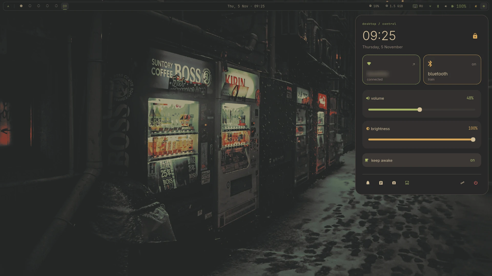
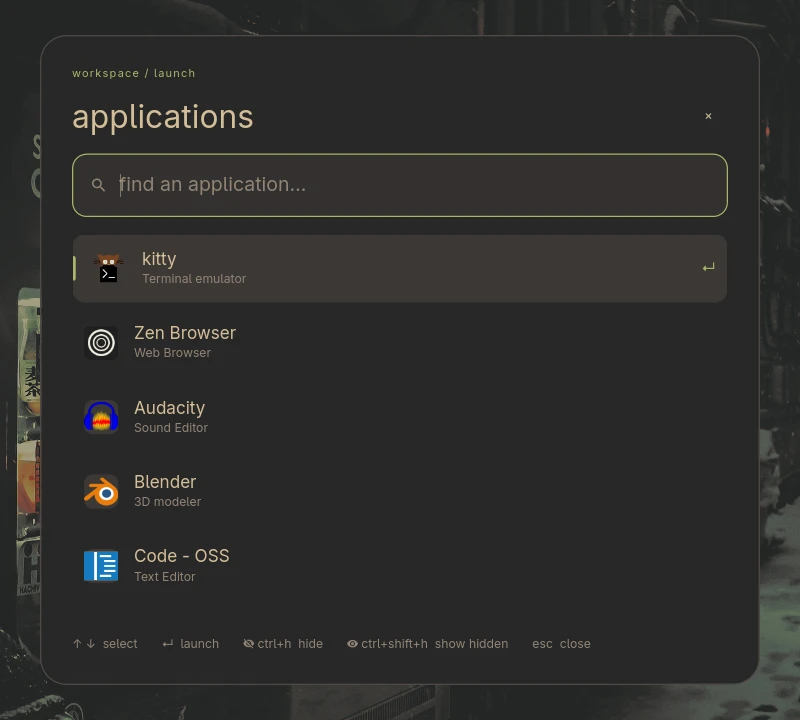
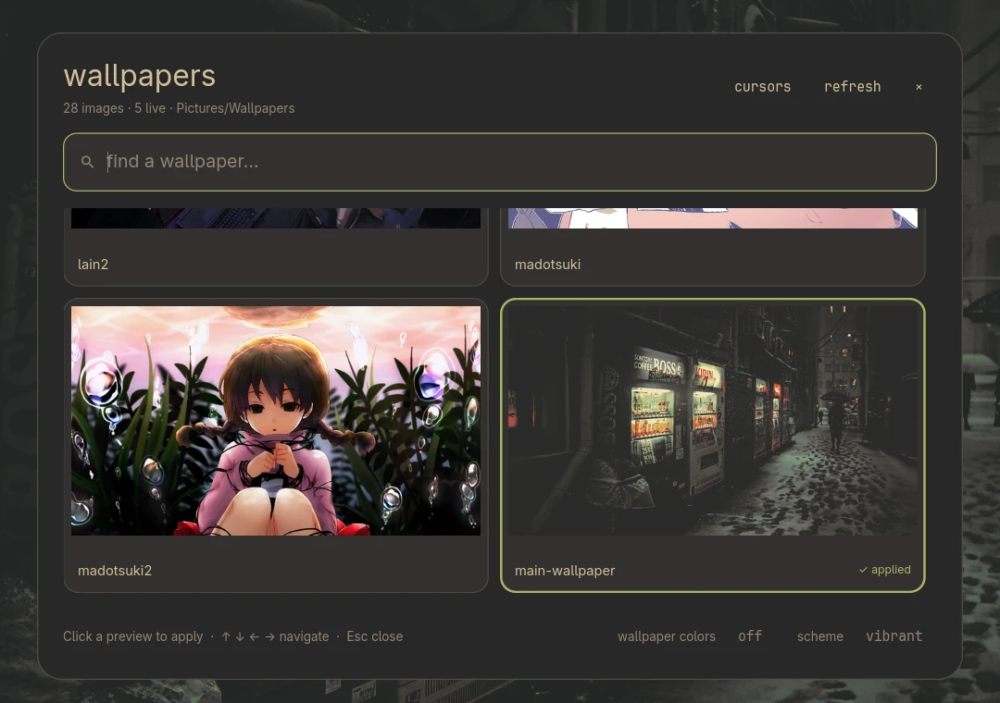
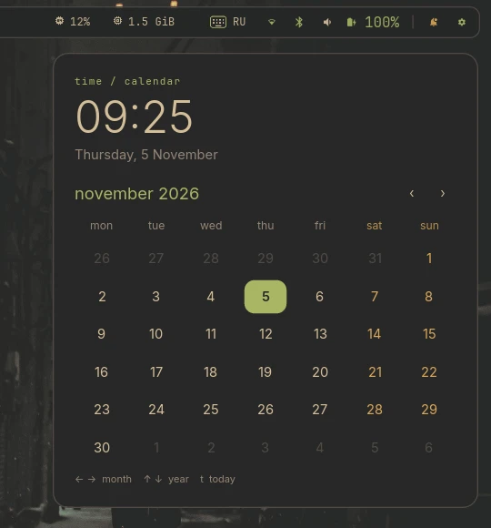
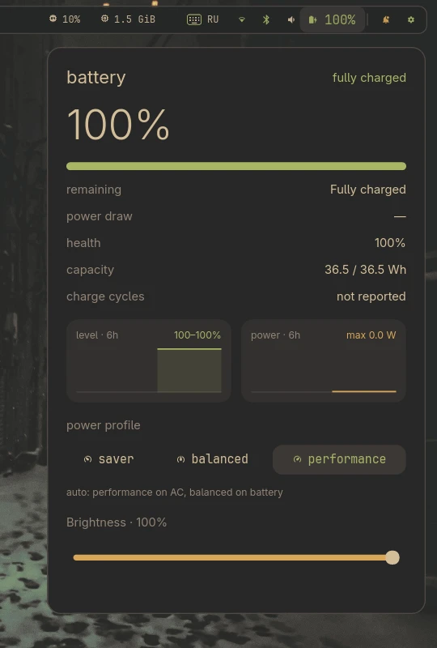
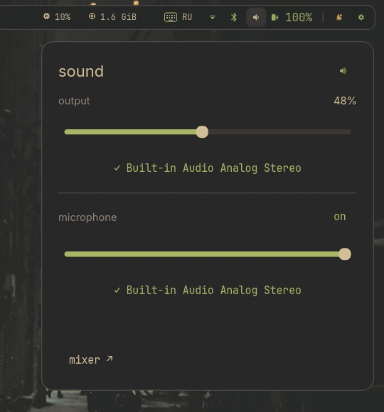

# chuhshell

a Wayland desktop shell for Hyprland, written in Rust. it draws the bar, panels, notifications, OSD and wallpaper of a gruvbox material desktop in one process, with no Qt, GTK or GPU stack.



chuhshell started as a port of [chuh's quickshell](https://github.com/chuh420/chuhs-quickshell), a QML config for Quickshell. it keeps the same layout, animations, IPC commands and state files, so you can switch between the two. on one 1920x1080 output it idles at about 29 MB RSS; the QML version with its Python helpers takes about 285 MB.

## features

- **bar**: workspaces, active window title, clock, CPU and RAM, keyboard layout, Wi-Fi, Bluetooth, volume, battery, tray and a keep awake toggle.
- **control center**: network and Bluetooth tiles, volume and brightness sliders, keep awake, shortcuts to notifications, clipboard, screenshots, wallpapers and the power menu.
- **launcher**: Unicode search over desktop entries, hidden apps, terminal entries in kitty, every app in its own `app.slice` scope.
- **notifications**: a full `org.freedesktop.Notifications` server with actions, images, markup, history and do not disturb.
- **tray**: StatusNotifierItem host with dbusmenu submenus.
- **Wi-Fi and Bluetooth**: iwd and BlueZ panels with scan, connect, forget, a passphrase agent and pairing prompts.
- **audio**: PipeWire output and input with device selection.
- **battery**: UPower details, level and power history, power profiles.
- **clipboard**: cliphist history with image thumbnails.
- **wallpapers**: a gallery with search, live wallpapers, a circle reveal on apply and an optional palette from the wallpaper through matugen.
- **cursors**: a cursor theme picker that can recolor themes to the current palette.
- **calendar**, **power menu** and a **system** panel with cores, temperatures, disk, load and top processes.

## screenshots

<table>
  <tr>
    <td></td>
    <td></td>
  </tr>
  <tr>
    <td></td>
    <td></td>
  </tr>
  <tr>
    <td></td>
    <td></td>
  </tr>
</table>

## before you install

chuhshell runs my desktop and assumes my setup. expect to edit code if yours differs:

- the compositor must be Hyprland. the shell talks to its IPC sockets for workspaces, windows and layouts.
- the colors, fonts and sizes are fixed in code. there is no config file.
- some actions call scripts at fixed paths. this repo ships two of them in `dist/`: `chuhctl` (lock, suspend, screenshots and the bind entry point) and `theme-reload` (pushes new colors to Hyprland, kitty, btop, cava and tmux). `~/.config/rice/wallpapers.py` applies wallpapers and comes from [chuh's quickshell](https://github.com/chuh420/chuhs-quickshell).
- state and caches live under `~/.local/state/rice`, `~/.local/state/quickshell/material` and `~/.cache/quickshell/material`, shared with the QML version.

## requirements

to build:

- Rust 1.99 or newer
- PipeWire headers and clang (for the `pipewire` crate bindings)
- libxkbcommon

to run:

- Hyprland
- fonts: Adwaita Sans and JetBrainsMono Nerd Font
- services: PipeWire with WirePlumber, UPower, power-profiles-daemon, iwd, BlueZ
- tools: `wpctl`, `brightnessctl`, `cliphist`, `wl-clipboard`, `rfkill`, `notify-send`, `xdg-open`, ImageMagick, ffmpeg, kitty, Python
- for `chuhctl`: hyprlock, grim, slurp, satty, pavucontrol
- optional: matugen for wallpaper colors; swaync and swayosd as fallbacks in `chuhctl`

## install

```sh
cargo build --release
install -Dm755 target/release/chuhshell ~/.local/bin/chuhshell
install -Dm755 dist/chuhctl ~/.local/bin/chuhctl
install -Dm755 dist/theme-reload ~/.config/rice/theme-reload
install -Dm644 dist/chuhshell.service ~/.config/systemd/user/chuhshell.service
systemctl --user daemon-reload
systemctl --user start chuhshell.service
```

the unit starts after `graphical-session.target` and stops with it. it conflicts with `swaync` and the Quickshell units, because they claim the same D-Bus names. start it from your Hyprland config or session script. logs go to `journalctl --user -u chuhshell.service`; set `CHUHSHELL_LOG=debug` for more.

turn off compositor animations for the `material-*` layer namespaces. the shell animates its own surfaces.

## usage

running `chuhshell` with no arguments starts the shell. a second instance exits if one already answers.

`chuhshell msg COMMAND` talks to the running shell over `$XDG_RUNTIME_DIR/chuhshell.sock`:

| command | action |
| --- | --- |
| `launcher`, `menu`, `calendar`, `wallpapers`, `clipboard`, `power` | open a centered panel |
| `wifi`, `bluetooth`, `audio`, `battery`, `system`, `notifications` | open an anchored panel |
| `close` | close the open panel |
| `awake`, `dnd` | toggle keep awake or do not disturb |
| `volumeUp`, `volumeDown`, `volumeMute`, `micMute` | change audio and show the OSD |
| `brightnessUp`, `brightnessDown` | change brightness and show the OSD |
| `osd KIND TEXT` | show a custom OSD message |
| `tray ID` | open a tray item menu |
| `theme [auto\|static\|toggle]` | wallpaper colors on or off |
| `theme scheme [NAME\|next]` | pick the matugen scheme |
| `inspect` | print the shell state as JSON |

for key bindings, call `chuhctl`. it forwards panel and media actions to the shell and falls back to swaync, swayosd, `wpctl` or `brightnessctl` when the shell is down. it also runs actions the shell does not own: `lock` (hyprlock), `suspend`, `screenshot` (slurp, grim and satty), `screenshot-output` and `audio` (pavucontrol).

```lua
bind("SUPER + D", hl.dsp.exec_cmd("chuhctl launcher"))
bind("SUPER + Space", hl.dsp.exec_cmd("chuhctl menu"))
bind("XF86AudioRaiseVolume", hl.dsp.exec_cmd("chuhctl volume-up"), { locked = true, repeating = true })
bind("Print", hl.dsp.exec_cmd("chuhctl screenshot"))
```

`chuhctl` names differ from IPC names in a few places: `volume-up`, `volume-down`, `volume-mute`, `microphone-mute`, `brightness-key-up`, `brightness-key-down`, `audio-panel` and `network`. see the script for the full list.

in the launcher, `Ctrl + H` hides the selected app and `Ctrl + Shift + H` shows hidden ones. the wallpaper gallery reads `~/Pictures/Wallpapers` and its `live wallpapers` folder; cursor themes go in `~/Pictures/Wallpapers/cursors`.

## how it works

| crate | role |
| --- | --- |
| `platform` | Wayland: outputs, layer surfaces, subsurfaces, popups, shm buffers, damage, input, cursor shape, idle inhibit |
| `ui` | toolkit: node tree, layout, tiny-skia painting, cosmic-text text, animations ported from Qt easing and springs, widgets |
| `services` | Hyprland, PipeWire, UPower, iwd, BlueZ, notifications, tray, apps, clipboard, wallpapers, theme |
| `shell` | the binary: shell state, surfaces, panels and IPC |

calloop drives everything on one thread. zbus futures run on its executor, and image decoding and file scans go to a small worker pool. the shell repaints only damaged regions after frame callbacks and frees surfaces you close.

## license

licensed under either of [Apache License 2.0](LICENSE-APACHE) or [MIT license](LICENSE-MIT) at your option.
